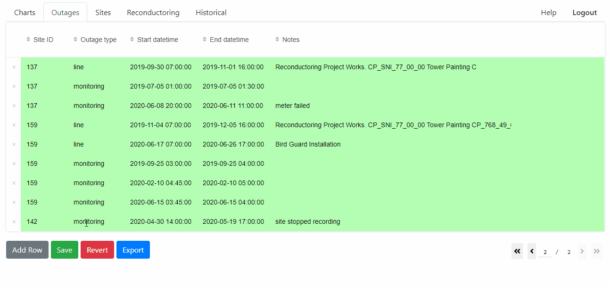
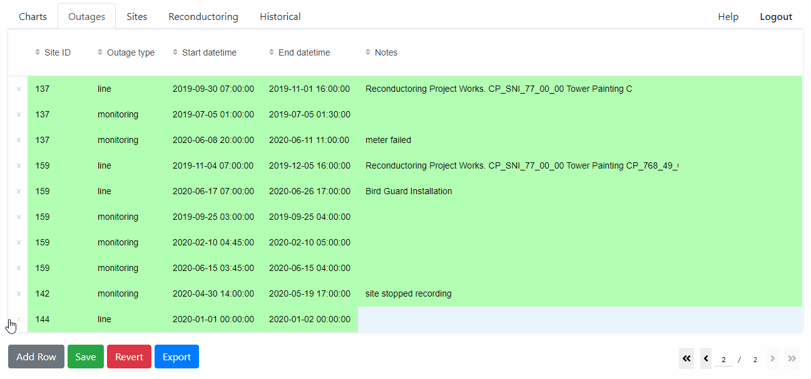

# Other Table Tabs

The Outages, Reconductoring, and Historical tabs are all editable tables (add,
edit, and delete rows, with write access), each with CSV export.

Data can be manually added to each of these tables if the user has write access.

After entering data press the *Save* button to commit the changes to the table.

## Outages
Logged periods when a site's monitoring was known to be down or 
corrupted; readings taken during a logged outage are excluded from charts.

## Reconductoring
When a new site is automatically drawn in via the API, the site ID will appear in the 'Sites' table. A new conductor type and reconductoring date can then be added to the 'Reconductoring' table. The reconductoring entries are automatically used in the 'Chart' tab when determining the conductor name and 'days since reconductoring'.

## Historical
Manually-surveyed results from before automated monitoring began, shown as an optional overlay on the Charts tab.
